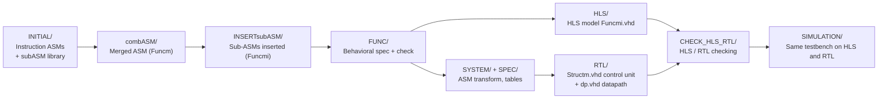

# CPU 16-8-16

A microcoded 16-bit CPU in VHDL, built from algorithmic state machine (ASM) specifications through high-level synthesis (HLS) down to a structural RTL design (control unit + datapath), with HLS-vs-RTL checking and a self-checking simulation testbench.

## Overview

Each instruction is described as an ASM: a flowchart of micro-operations and conditions. Shared steps (instruction fetch, indexed addressing, DMA servicing) are written once as reusable sub-ASMs. The Synthagate toolchain merges the ASMs, inserts the sub-ASMs, and generates:

- a behavioral **HLS model** (`HLS/Funcmi.vhd`), and
- a structural **RTL design**: control unit `RTL/Structm.vhd`, datapath `RTL/dp.vhd`, top level `RTL/top.vhd`.

Both models were simulated in ModelSim/Questa against the same test program. Tools: ASMCreator, Synthagate, ModelSim/Questa.

## Architecture

Widths below are taken from the VHDL and the HLS specification (`SPEC/Funcmi.spec`).

| Element | Width / size | Evidence |
|---|---|---|
| Register file `BOR` (`r0`-`rF`) | **16 registers x 16 bits**, 4-bit register address | `SPEC/Funcmi.spec:4`, `HLS/Funcmi.vhd:29`, `RTL/bor_4adr_16bit.vhd:8-9` |
| Instruction registers `ir1`, `ir2` | 16 bits each | `HLS/Funcmi.vhd:37-38`, `RTL/dp.vhd:76-77` |
| Buffer register `br`, ALU result `ralu` | 16 bits | `HLS/Funcmi.vhd:35,43` |
| Program counter `pc`, DMA address counter `mac` | 16 bits | `HLS/Funcmi.vhd:41-42`, `RTL/dp.vhd:173,178` |
| Program memory `M0` | 65,536 x **8 bits** (16-bit address) | `SPEC/Funcmi.spec:5`, `COMPONENTS/memAlt65536x8.vhd:8-9` |
| Data memory `M1` | 65,536 x 16 bits (16-bit address) | `SPEC/Funcmi.spec:6`, `COMPONENTS/memAlt65536x16.vhd:8-9` |
| ALU operands / result | 16 bits, 5-bit control | `COMPONENTS/alu.vhd:8-11` |
| I/O and DMA ports (`inpr`, `outr`, `ext_*`) | 16 bits | `RTL/top.vhd:9-16` |

In short: **16-bit instructions, 16-bit registers and ALU, 16-bit addresses, and a byte-wide (8-bit) program memory.** Instructions are one or two 16-bit words. Each word is fetched from `M0` as two consecutive bytes, and `pc` advances by one per byte (`HLS/Funcmi.vhd:114,157,228,256`).

The datapath (`RTL/dp.vhd`) contains the register file, `ir1`/`ir2`/`br`/`ralu`, the `pc` and `mac` counters, the zero flag `zf`, the ALU, an extra 16-bit adder for indexed addressing, both memories, and the multiplexers that route data between them.

The top-level interface has `clk`, `rst`, a start input `s`, an `idle` output, 16-bit `inpr`/`outr`, and a DMA port (`dma`, `m`, `ext_rdwr`, `ext_adr`, `ext_in`, `ext_out`) for loading `M0` or `M1` from outside.

## Note on the naming

The project report (`ward16-8-16.pdf`) reads "16-8-16" as *16-bit instructions, 8-bit general-purpose registers, 16-bit addressing*. The VHDL does not match the middle term. The general-purpose register file is 16 x 16 bits in the spec, the HLS model and the RTL. The code is the authoritative description of what was built.

The 8-bit figure does appear in the implementation, in two places:

- **Program memory `M0` is 8 bits wide.** This is the only 8-bit storage element. Every 16-bit instruction word is assembled from two byte reads.
- **Byte-wise loading of `ir1`, `ir2` and `br`.** These are built from two 8-bit halves with separate enables (`RTL/reg_16bit_2en.vhd:31-32`), fed by 8-bit multiplexers (`RTL/dp.vhd:68-69,113,118`). That way each byte from `M0` can be written into its half.

So "8" most plausibly refers to the 8-bit program-memory word, not to the register width.

## Instruction Set

```
ir1:  [15..11] opcode | [10..9] - | [8] mode | [7..4] Rd | [3..0] Rs / index
ir2:  [15..0]  immediate or 16-bit address   (two-word instructions only)
```

`ir1(8)` selects immediate (`ir2` is the value or target) or direct (`M1[ir2]`). If the index field `ir1(3..0)` is non-zero, the address is indexed: `ir2 := ir2 + BOR[ir1(3..0)]`.

| Mnemonic | Opcode | Behavior |
|---|---|---|
| `add` / `and` / `sub` | `00001` / `00010` / `00011` | `Rd := Rd op Rs`, sets `zf` |
| `com` / `inc` | `00100` / `00101` | `Rd := not Rd` / `Rd + 1`, sets `zf` |
| `shl` / `shr` | `00110` / `00111` | Logical shift by 1, sets `zf` |
| `bun` | `01000` | Unconditional branch, immediate or direct, optional indexing |
| `bcz` | `01001` | Branch on the zero flag, same addressing modes as `bun` |
| `lod` | `10001` | `Rd := ir2` or `Rd := M1[addr]` |
| `str` | `10011` | `M1[addr] := Rd` |
| `inp` / `out` | `11000` / `11001` | `Rd := inpr` / `outr := Rd` (through `br`) |

All seven ALU instructions share one ASM (`ao`). The opcode bits feed the ALU control input directly. Codes `11010`-`11101` (`ion`, `iof`, `ski`, `sko`) are reserved in `INITIAL/encoding.xml`, but the repository has no ASMs for them.

## Design Flow


## Verification

- **Tool checks.** `combASM/Funcm.chk` reports "ASM is correct". `FUNC/Funcmi.log`, `CHECK_HLS_RTL/HLS_checking.log`, `CHECK_HLS_RTL/RTL_checking.log` and the functional checks in `Synthagate.log` all report no errors.
- **Test program.** `SIMULATION/NewTB/assembly_10tests.txt` covers `lod` immediate, `lod`/`str` long direct (plain and indexed), `bun` immediate / long direct / long direct indexed, `add`, and `bcz` long direct (plain and indexed, each with the zero flag set and clear). Every branch test is followed by an instruction that must be skipped.
- **Self-checking testbenches.** `Top_tb.vhd` (RTL) and `Funcmi_tb.vhd` (HLS) load the assembled program into memory over the DMA port, run it, and check `outr` with 11 `assert` statements. The expected values are `0008`, `0008`, `1234`, `0002`, `0003`, `0002`, `0008` and four times `0001`.
- **Results.** The project report states that the HLS and RTL simulations produced matching results, and it includes `outr` waveforms from both. The waveform databases are `SIMULATION/HLS/vsim.wlf` and `SIMULATION/RTL/vsim.wlf`.

## Repository Structure

```
ward16-8-16.pdf          Project report
ward16-8-16/
├── INITIAL/             Instruction ASMs, subASM/ library, encoding.xml
├── combASM/             Merged ASM
├── INSERTsubASM/        ASM with sub-ASMs inserted
├── FUNC/  HLS/          HLS spec and generated behavioral VHDL
├── SYSTEM/  SPEC/       Transformed ASM tables, external/component specs
├── COMPONENTS/          Hand-written ALU and memories
├── RTL/                 top.vhd, Structm.vhd (control), dp.vhd (datapath), library parts
├── CHECK_HLS_RTL/       HLS / RTL checking logs
├── SIMULATION/          Testbenches, test program, ModelSim projects
└── Synthagate.log       Toolchain log
```

## Documentation

The project report, with the design overview, toolchain, results and simulation waveforms, is in [`ward16-8-16.pdf`](./ward16-8-16.pdf). Where the report and the VHDL differ, the VHDL is authoritative (see [Note on the naming](#note-on-the-naming)).

## Author

**Ward Keadan**: [GitHub](https://github.com/wardkadan1) · [Portfolio](https://wardkeadan.vercel.app)
